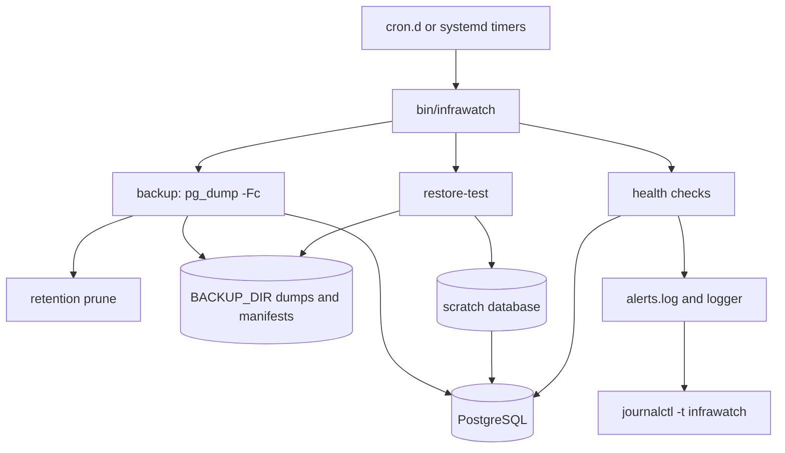

# InfraWatch

InfraWatch is a small Linux toolkit for PostgreSQL backups and host health checks. It dumps one database with `pg_dump`, prunes old dumps, and restores the newest dump into a scratch database to prove the file can be read. A separate health command checks load, memory, disk, systemd units, and long-running queries, and writes an alert when a threshold is crossed.

Backups are logical snapshots. This is not WAL archiving and it will not restore to a point in time between dumps.

## Features

- `pg_dump` custom-format backups, with a sha256 manifest next to each file.
- Retention by age, with a floor so the newest few dumps are kept even if they are older than the window.
- A scheduled restore test that loads the newest dump into a scratch database and compares per-table row counts with the source.
- An explicit `restore` command that will not replace the source database, or any existing database, unless `--force` is set.
- Health checks for CPU load, memory, disk usage, systemd unit state, and long-running queries.
- Alerts on transition, repeated while the check stays bad, and a recovery line when it clears. `logger -t infrawatch` sends the same events to the journal.
- cron and systemd timers for the backup, the restore test, and the health check. Use one of them.
- logrotate for the log directory.
- `triage` collects a first-response report without changing the database. Restore and triage runbooks are in `docs/runbooks/`.

## Architecture



`backup` and `prune` share a lock, so a prune cannot delete a file that a dump is still writing. `restore` and `restore-test` share a different lock. Health has its own lock. Locks are `flock` on the state directory, which needs to be a local filesystem.

Each dump is `<database>_<UTC timestamp>.dump` plus a `.manifest`. The manifest is written only after `pg_dump` exits 0 and the file is non-empty. A failed dump deletes the partial file. Restore checks the sha256 before it calls `pg_restore`.

The restore test uses `--no-owner` and compares public tables (`relkind = 'r'`). On success the scratch database is dropped. On failure it is left in place so you can inspect it. `KEEP_SCRATCH=1` keeps it after a success too.

Health exits 0 when every check is inside its threshold, 1 when a threshold or a unit state is breached, and 2 when a check could not be observed (no systemd bus, database down, `df` failed). Those are different outcomes: an unknown unit state is not reported as "healthy".

## Folder structure

```
bin/infrawatch              command entrypoint
bin/install.sh              host install into /opt and /etc
bin/lib/                    backup, restore, health, triage
config/infrawatch.conf      defaults for a checkout
config/infrawatch.system.conf
config/logrotate/infrawatch
cron/infrawatch             /etc/cron.d snippet
systemd/                    oneshot services and timers
sql/grants.sql              role privileges for a real cluster
sql/sample_schema.sql       schema loaded by docker-compose
docs/runbooks/              restore and first-response triage
docker-compose.yml          local Postgres 16
Dockerfile                  client image with the scripts
tests/                      unit tests and one integration test
```

A checkout writes backups, logs, and lock state under `var/`. That directory is gitignored. A host install uses `/var/backups/infrawatch`, `/var/log/infrawatch`, and `/var/lib/infrawatch`.

## Running locally

You need Bash, `pg_dump` / `pg_restore` / `psql` from a client at least as new as the server, and a database the role can dump. The role also needs `CREATEDB` and `CONNECT` on the `postgres` database so restore tests can create the scratch database. `sql/grants.sql` is the privilege set; seeing other sessions' queries needs `pg_monitor`.

Docker Compose starts a Postgres 16 server with the sample schema and the same user as `.env.example`:

```bash
cp .env.example .env
docker compose up -d --wait
./bin/infrawatch backup
./bin/infrawatch restore-test
./bin/infrawatch health
./bin/infrawatch triage
./bin/infrawatch logs
```

Without Docker, point `.env` at a Postgres you already run. `PGHOST`, `PGPORT`, `PGUSER`, `PGPASSWORD`, and `PGDATABASE` are the usual libpq variables. The password is not stored in `config/infrawatch.conf`.

```bash
cp .env.example .env
# edit .env
./bin/infrawatch backup
```

`infrawatch restore --dump PATH --target NAME` loads a dump into a new database. Add `--force` only when you mean to drop that target. Add `--no-owner` on a new cluster after the role exists.

Thresholds, retention, the scratch database name, and `SYSTEMD_UNITS` live in `config/infrawatch.conf`. A checkout reads that file. `INFRAWATCH_CONFIG` overrides it. Values already set in the environment or `.env` win over the defaults in the file.

`ALERT_COMMAND`, if set, is an executable. On each alert and on recovery it gets `ALERT_SEVERITY`, `ALERT_CHECK`, and `ALERT_MESSAGE` in the environment. Use a small wrapper for mail or a webhook. There is no vendor-specific pager in the tree.

## Host install

`bin/install.sh` copies the scripts to `/opt/infrawatch`, the system config to `/etc/infrawatch/infrawatch.conf`, a cron file, systemd units, and logrotate. It does not enable the timers. An existing config file is left alone.

```bash
sudo bin/install.sh
sudo cp /etc/infrawatch/infrawatch.env.example /etc/infrawatch/infrawatch.env
sudoedit /etc/infrawatch/infrawatch.env
sudo chown root:postgres /etc/infrawatch/infrawatch.env
sudo chmod 640 /etc/infrawatch/infrawatch.env
```

Then pick one scheduler. Timers:

```bash
sudo systemctl enable --now \
  infrawatch-backup.timer \
  infrawatch-restore-test.timer \
  infrawatch-healthcheck.timer
sudo rm /etc/cron.d/infrawatch
```

Or leave `/etc/cron.d/infrawatch` in place and do not enable the timers. The cron jobs run as `postgres`. The backup runs at 02:15, the restore test at 03:30, and health every five minutes. Timers use the same clock times. `Persistent=true` runs a job that was missed while the host was down. The backup and restore timers add a few minutes of random delay so a fleet of hosts does not dump at the same second.

The systemd units set `SyslogIdentifier=infrawatch`. `infrawatch logs` runs `journalctl -t infrawatch` when the journal has data, and otherwise prints the file log. logrotate rotates `/var/log/infrawatch/*.log` daily for 14 days.

The client image packages the same scripts against the Postgres 16 client tools:

```bash
docker build -t infrawatch .
docker run --rm --network host --env-file .env infrawatch health
```

## Tests

Unit tests do not need a database. ShellCheck covers the scripts.

```bash
make test
```

The integration test needs PostgreSQL. With Compose:

```bash
docker compose up -d --wait
make test-integration
```

It creates a database named `infrawatch_it`, dumps it, restores into a scratch database, checks a row, prunes, forces a disk alert, and flags a `pg_sleep` session. It drops those databases at the end. `make check` runs the unit tests and the integration test.

`systemd-analyze calendar` checks the timer expressions when that command is available. `logrotate -d` checks the logrotate file.

## Design notes

Custom format (`-Fc`) is one file, compressed, and `pg_restore --list` can read the archive before a restore starts. Plain SQL dumps are easier to glance at and worse to verify.

The manifest is a sidecar rather than a note inside the dump so a truncated file fails the checksum even if `pg_restore` would have errored later anyway.

Retention is age plus a minimum count. A host that is off for longer than `RETENTION_DAYS` should not come back to an empty backup directory.

The scratch restore compares row counts, not just "pg_restore exited 0". An empty restore of a database that has tables fails the comparison. Counts are the whole public table, so this is the wrong test to schedule every few minutes on a very large database. Once a day, after the backup, is the intended use. The scratch copy needs about as much free disk as the dump's restored size for the length of the test.

`--no-owner` is only the default on the test path. A real restore keeps ownership unless you pass `--no-owner`, which is what you want when the target cluster does not have the original owner role yet.

Load is compared per CPU so the same config means something on a 2-core VM and a larger host. Memory uses `MemAvailable`. Disk uses `df -P` and alerts when the used percent is greater than the threshold, not greater than or equal, so a filesystem sitting exactly on the line does not flap.

systemd state comes from `systemctl is-active`. `active` is ok. `inactive` and `failed` alert. No output, which is what you get when the machine has no systemd bus, is an error.

Long-query alerts ignore `pg_dump`, `pg_restore`, and `application_name=infrawatch`. A dump that runs for hours is visible in the backup log. The health check is for application queries.

Alert state is one file per check under the state directory. The first breach alerts, later runs inside `ALERT_REPEAT_SECONDS` only log that it is still failing, and a return to ok writes `severity=ok`. That keeps a five-minute timer from paging on every tick.

Passwords stay in `.env` or `/etc/infrawatch/infrawatch.env`. Neither the system config nor the repo config has a password field. `.env` is gitignored. Dumps and logs are created with umask 077 because a dump contains row data and a long-query alert contains SQL text.

## Runbooks

- [Restore](docs/runbooks/restore.md)
- [Incident triage](docs/runbooks/incident-triage.md)
